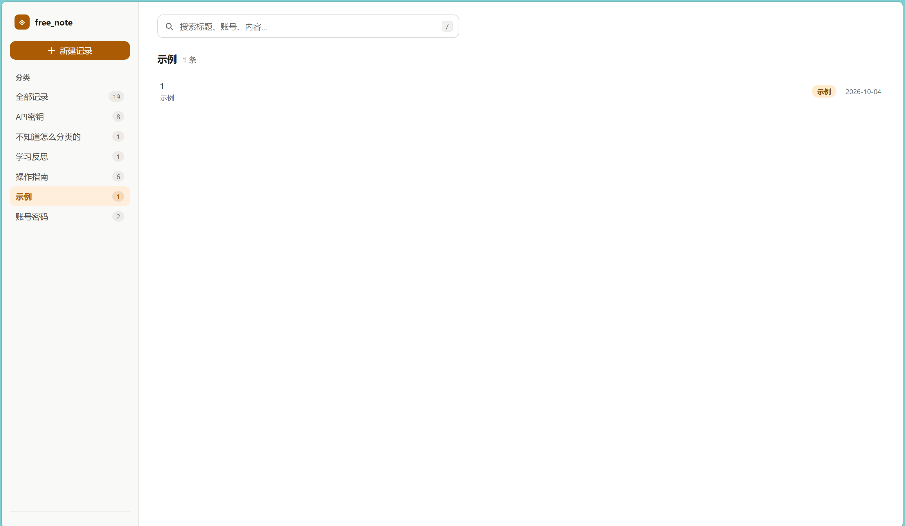

# 界面设计

free_note 的界面围绕日常查阅设计：搜索入口保持醒目，分类数量一眼可见，列表适合快速扫读，详情在右侧展开。

## 视觉

- 纯白主界面与浅色侧栏，使用暖蜂蜜色强调主要操作及当前分类。
- 分类标签采用六组柔和配色，按分类名称稳定分配颜色。
- 中文优先的系统字体；密码和密钥等字段使用等宽字体。
- 用留白、文字层级和细分隔线组织信息。

## 交互

- 左侧新建按钮、分类导航与锁定入口；主区展示搜索和记录列表。
- 详情抽屉包含字段、复制按钮、显示切换、创建及更新时间。
- 新建、编辑和删除确认使用原生 `dialog`。
- `/` 聚焦搜索，`N` 新建，`Esc` 关闭详情或弹窗。
- 窄屏下侧栏收缩，详情抽屉扩展为全屏。
- 支持 `prefers-reduced-motion`，减少动画时使用即时状态切换。

